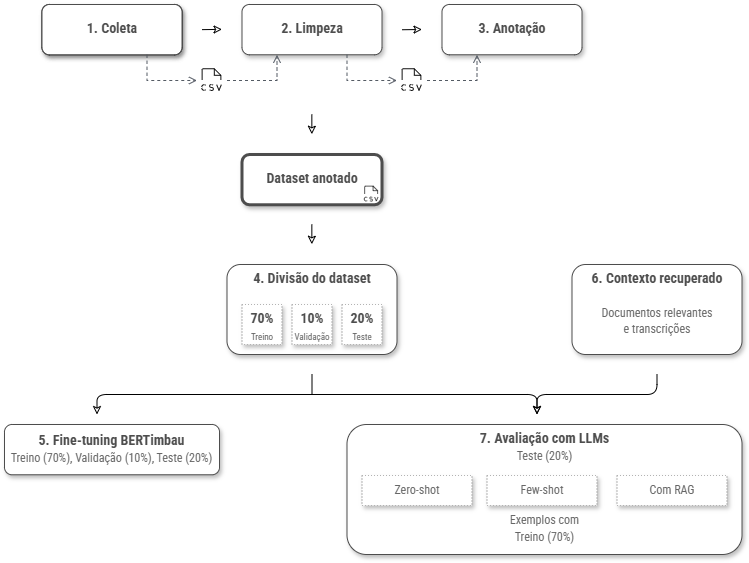

# Brazilian Transphobia RAG Analysis



## pt-br

Este repositório contém o código-fonte usado em um TCC sobre classificação e análise de discurso transfóbico em comentários brasileiros do YouTube. O projeto inclui coleta e tratamento de dados, ferramenta de anotação, modelos supervisionados, recuperação de documentos, experimentos com LLMs e RAG.

### Estrutura

- [`annotation-system/`](annotation-system/README.md): ferramenta web de anotação.
- [`scripts/etl/`](scripts/etl/README.md): coleta, limpeza e contagem dos comentários.
- [`scripts/bertimbau/`](scripts/bertimbau/README.md): preparação dos dados e modelos supervisionados com BERTimbau/SVM.
- [`scripts/rag/docs/`](scripts/rag/docs/README.md): coleta de documentos, transcrições, chunking e índices FAISS.
- [`scripts/rag/pipeline/`](scripts/rag/pipeline/README.md): classificação com LLMs, prompting, RAG e avaliação.

### Instalação

```bash
python -m venv .venv
source .venv/bin/activate
pip install -r requirements-all.txt
```

No Windows PowerShell:

```powershell
python -m venv .venv
.\.venv\Scripts\Activate.ps1
pip install -r requirements-all.txt
```

Para coleta via YouTube Data API, crie um arquivo `.env` a partir de `.env.example` e preencha `YOUTUBE_API_KEY`.

### Como citar

```bibtex
@misc{carvalho2026transphobia_rag_code,
  author       = {Carvalho, V. G.},
  title        = {Brazilian Transphobia RAG Analysis: Source Code},
  year         = {2026},
  howpublished = {GitHub repository},
  url          = {https://github.com/v-giorgio/brazilian-transphobia-rag-analysis},
  note         = {Undergraduate thesis source code}
}
```

### Licença

O código-fonte é licenciado sob GNU AGPLv3. Materiais acadêmicos e documentais são licenciados sob CC BY-NC-ND 4.0. Dados, comentários, transcrições e materiais de terceiros podem estar sujeitos aos termos de suas fontes originais.

## en

This repository contains the source code used in an undergraduate thesis on classifying and analyzing transphobic discourse in Brazilian Portuguese YouTube comments. It includes data collection and processing, an annotation tool, supervised models, document retrieval, LLM experiments, and RAG pipelines.

### Structure

- [`annotation-system/`](annotation-system/README.md): web annotation tool.
- [`scripts/etl/`](scripts/etl/README.md): comment collection, cleaning, and counting.
- [`scripts/bertimbau/`](scripts/bertimbau/README.md): data preparation and supervised BERTimbau/SVM models.
- [`scripts/rag/docs/`](scripts/rag/docs/README.md): document collection, transcripts, chunking, and FAISS indices.
- [`scripts/rag/pipeline/`](scripts/rag/pipeline/README.md): LLM classification, prompting, RAG, and evaluation.

### Setup

```bash
python -m venv .venv
source .venv/bin/activate
pip install -r requirements-all.txt
```

On Windows PowerShell:

```powershell
python -m venv .venv
.\.venv\Scripts\Activate.ps1
pip install -r requirements-all.txt
```

For YouTube Data API collection, create a `.env` file from `.env.example` and set `YOUTUBE_API_KEY`.

### Citation

```bibtex
@misc{carvalho2026transphobia_rag_code,
  author       = {Carvalho, V. G.},
  title        = {Brazilian Transphobia RAG Analysis: Source Code},
  year         = {2026},
  howpublished = {GitHub repository},
  url          = {https://github.com/v-giorgio/brazilian-transphobia-rag-analysis},
  note         = {Undergraduate thesis source code}
}
```

### License

Source code is licensed under GNU AGPLv3. Academic and documentary materials are licensed under CC BY-NC-ND 4.0. Data, comments, transcripts, and third-party materials may be subject to their original source terms.
