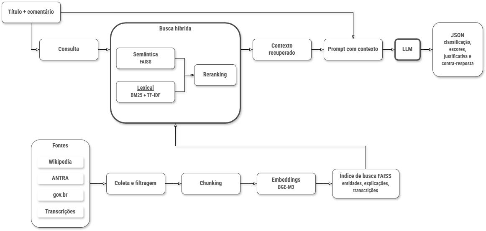

# LLMs and RAG



## pt-br

Scripts para classificação com LLMs em `zero-shot`, `few-shot` e RAG, além da avaliação de métricas de classificação e RAGAS.

### Pré-requisito local

Os comandos abaixo assumem uma API compatível com OpenAI. Para Ollama local:

```bash
ollama serve
```

### Zero-shot

```bash
python scripts/rag/pipeline/classifier_llm_zero_shot_v2.py --task speech --model qwen3:14b --limit 10
```

### Few-shot

```bash
python scripts/rag/pipeline/classifier_llm_few_shot_v2.py --task speech --model qwen3:14b --limit 10
```

### RAG

```bash
python scripts/rag/pipeline/classifier_llm_rag_v12.py --task speech --model qwen3:14b --rag-mode wiki --limit 10
python scripts/rag/pipeline/classifier_llm_rag_v12.py --task speech --model qwen3:14b --rag-mode transcripts --limit 10
python scripts/rag/pipeline/classifier_llm_rag_v12.py --task speech --model qwen3:14b --rag-mode both --limit 10
```

### Avaliação

```bash
python scripts/rag/pipeline/eval_classifier_llm_v6.py
python scripts/rag/pipeline/eval_ragas.py
```

### Saídas

- `scripts/rag/pipeline/data/final/output/`: predições por estratégia.
- `scripts/rag/pipeline/data/final/metrics/`: métricas de classificação e RAGAS.

## en

Scripts for LLM classification with `zero-shot`, `few-shot`, and RAG, plus classification and RAGAS evaluation.

### Local prerequisite

The commands below assume an OpenAI-compatible API. For local Ollama:

```bash
ollama serve
```

### Zero-shot

```bash
python scripts/rag/pipeline/classifier_llm_zero_shot_v2.py --task speech --model qwen3:14b --limit 10
```

### Few-shot

```bash
python scripts/rag/pipeline/classifier_llm_few_shot_v2.py --task speech --model qwen3:14b --limit 10
```

### RAG

```bash
python scripts/rag/pipeline/classifier_llm_rag_v12.py --task speech --model qwen3:14b --rag-mode wiki --limit 10
python scripts/rag/pipeline/classifier_llm_rag_v12.py --task speech --model qwen3:14b --rag-mode transcripts --limit 10
python scripts/rag/pipeline/classifier_llm_rag_v12.py --task speech --model qwen3:14b --rag-mode both --limit 10
```

### Evaluation

```bash
python scripts/rag/pipeline/eval_classifier_llm_v6.py
python scripts/rag/pipeline/eval_ragas.py
```

### Outputs

- `scripts/rag/pipeline/data/final/output/`: predictions by strategy.
- `scripts/rag/pipeline/data/final/metrics/`: classification and RAGAS metrics.
